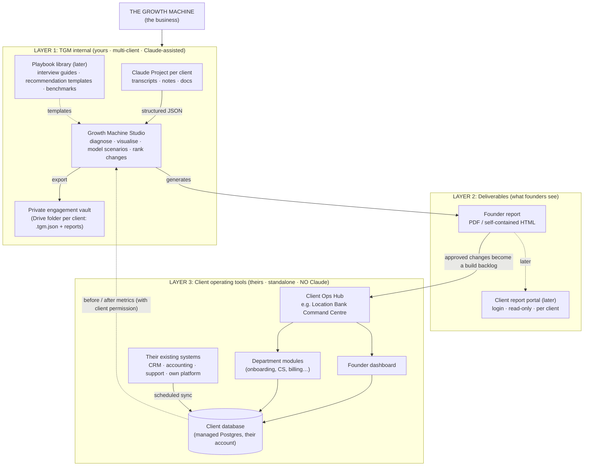
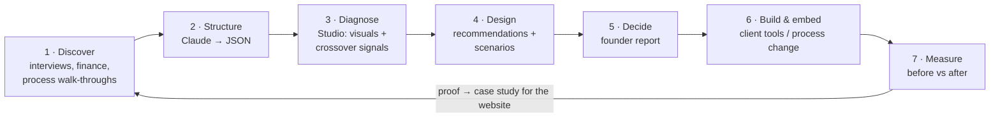
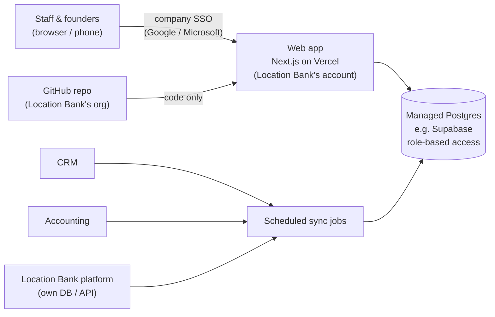

# The Growth Machine: tool ecosystem

How the tools fit together, what gets built in what order, and the plan for Location Bank.

## 1. Hierarchy

There are three layers. The most important rule is the hard line between **your** tools (which can use Claude) and the **client's** tools (which must stand alone).

## 2. The engagement loop

This maps onto the website's *Diagnose → Design → Execute → Embed* method. Step 7 is where the "verified case-study metrics" in `LAUNCH_CHECKLIST.md` will come from.

## 3. What to build, in what order

| # | Tool | Owner | Depends on Claude? | Status |
|---|---|---|---|---|
| 1 | **Growth Machine Studio** | TGM | Optional (input only) | **v1 built**: `tools/growth-machine/` |
| 2 | Founder report export | TGM → client | No | **Built** into the Studio |
| 3 | Interview guide + discovery checklist | TGM | No | Next. Without this, Studio data will be uneven |
| 4 | Location Bank founder dashboard | Location Bank | **No** | After discovery (≈ weeks 3–5) |
| 5 | Location Bank department tools | Location Bank | **No** | Only where the diagnostic proves the need |
| 6 | Client report portal | TGM | No | Once 2–3 clients exist. A PDF is enough until then |
| 7 | Playbook library | TGM | Optional | Grows from each engagement. This becomes your IP |

### Why the Studio is a single local file (and not yet a hosted app)

- **Confidentiality.** It will hold salaries and redundancy scenarios. A file on your machine plus a private Drive folder has a smaller attack surface than a hosted database. Build hosting once there is a reason (multiple consultants, client log-ins).
- **Zero running cost and zero maintenance** while the method is still changing week to week.
- **Claude in, standalone out.** Claude formats the data, but the tool and its reports never call Claude. This keeps it fast, private and portable.
- **Upgrade path.** The JSON schema is the contract. Moving to a hosted Next.js + database app later is a port, not a rewrite.

### Why founders get an exported report rather than access to the Studio

The Studio shows working: raw interview notes, rejected ideas, individual salaries. Founders need the conclusions. An exported report is controlled (you choose the scenario, sections and anonymisation), permanent (a dated record of what you advised), and costs nothing to host. Revisit a portal when a client wants to see progress between meetings.

## 4. Location Bank: client tools plan

**What Location Bank is (public sources):** a South African software company. It keeps multi-location brands' listings accurate across Google Maps, Apple Maps, Bing and others, and manages reviews and reputation. It is active in South Africa and India.

### Do not build yet

The diagnostic decides what gets built. Building before discovery risks automating the wrong process or duplicating something their own product already does. What follows is a **hypothesis list** to test in interviews, not a plan.

| Likely pain (to test) | Possible tool | Build or buy? |
|---|---|---|
| No single view of the business for the founders (ARR, locations under management, churn, pipeline, cash, debtors) | **Founder dashboard** pulling from CRM, accounting and their platform | Usually *buy/configure* first (e.g. Metabase or Looker Studio on their data). Custom only if that fails |
| Onboarding new brands means messy location data (spreadsheets, cleaning, re-keying) | **Validated intake portal** | Possibly *build*. This is core to their operation |
| Billing out of sync with locations actually under management | **Usage-based billing sync** | Usually *buy* (billing tool) + an integration |
| Customer Success time spent producing reports | Check first whether their own product's reporting is underused before building anything | Often a *product/process* fix, not a new tool |
| Renewals and account health tracked in people's heads | **Account health view** in the existing CRM | *Configure* the existing CRM |

**Important:** Location Bank is a software company with its own developers. For each tool, ask:

- Should their dev team build it in their own stack?
- Should you build it?
- Should they configure something off the shelf?

The answer affects cost, ownership and who maintains it after you leave.

### Standalone architecture for any Location Bank tool

Your requirement: online, used by all staff and the founders, data secure, no reliance on Claude or on anything stored here.

Key decisions and why:

- **GitHub stores code, not data.** A repo is not a database: it has no access control per record, no audit trail per user and no concurrent editing, and it is easy to leak by accident. Their data belongs in a managed database with logins and roles.
- **Everything is in Location Bank's accounts** (GitHub org, hosting, database). They own it, they can't be locked out, and it survives the end of your contract. You get collaborator access.
- **Log-in through their existing Google or Microsoft accounts.** When someone leaves, removing their company account removes their access.
- **Roles:** founder (everything), manager (their department), staff (their own work).
- **Sync data from their systems instead of re-typing it.** Otherwise the new tool becomes one more manual process.
- **Same stack as the TGM website (Next.js).** You and Claude Code can maintain it, and so can any developer they hire.
- **POPIA:** staff and client personal data is involved. Check where the database is hosted, and get their sign-off on cross-border storage.

## 5. Risks to manage

- **Staff candour.** If staff believe the interviews lead to firings, they will tell you less. Frame discovery around workload and friction, not headcount. Keep people-related recommendations in the founder-only report.
- **Retrenchments in South Africa** must follow a formal process (LRA section 189: consultation, selection criteria, notice). The Studio models *roles*, not decisions about individuals. Present people changes as role redundancy, with HR/legal advice before any action.
- **IP and scope.** Make sure the contract says who owns code built for Location Bank, and whether building tools is inside the current fee or a separate phase.
